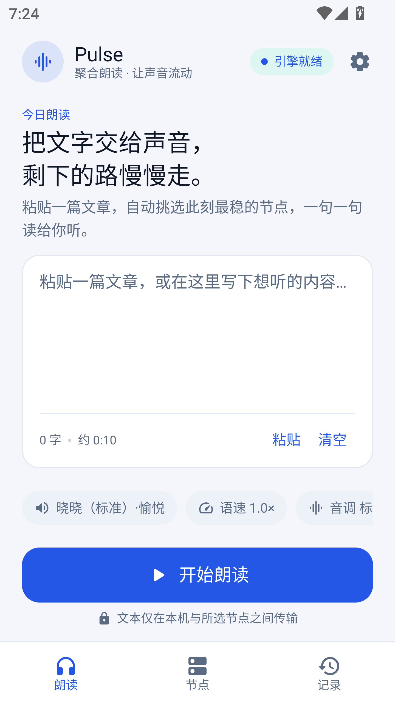
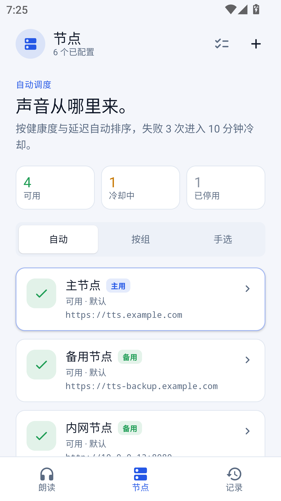
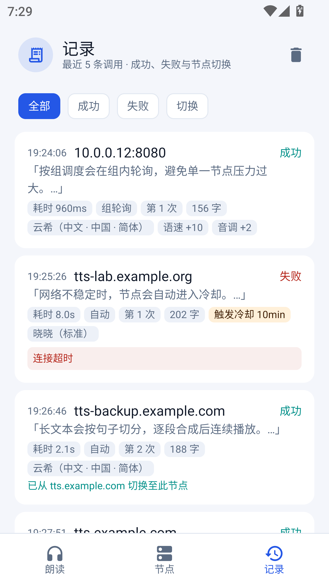
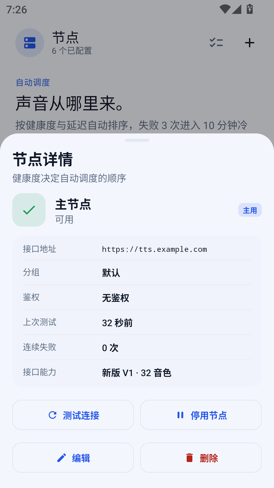
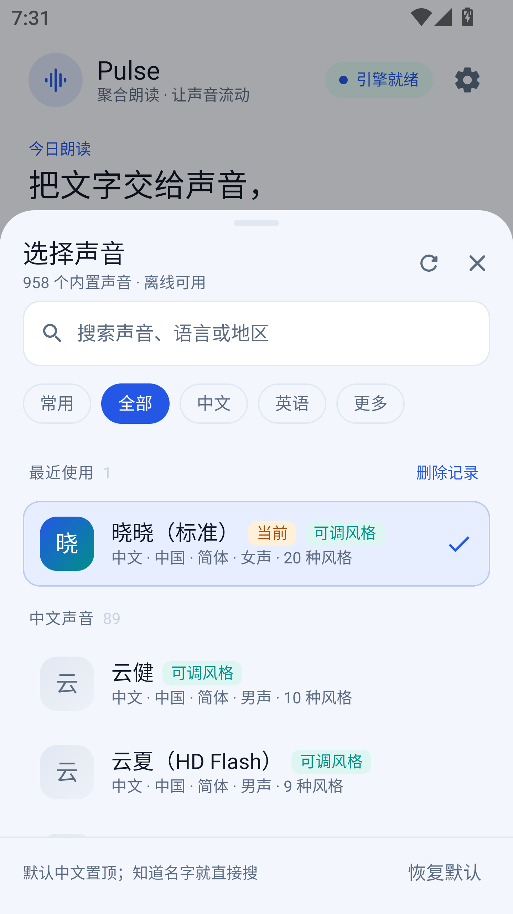
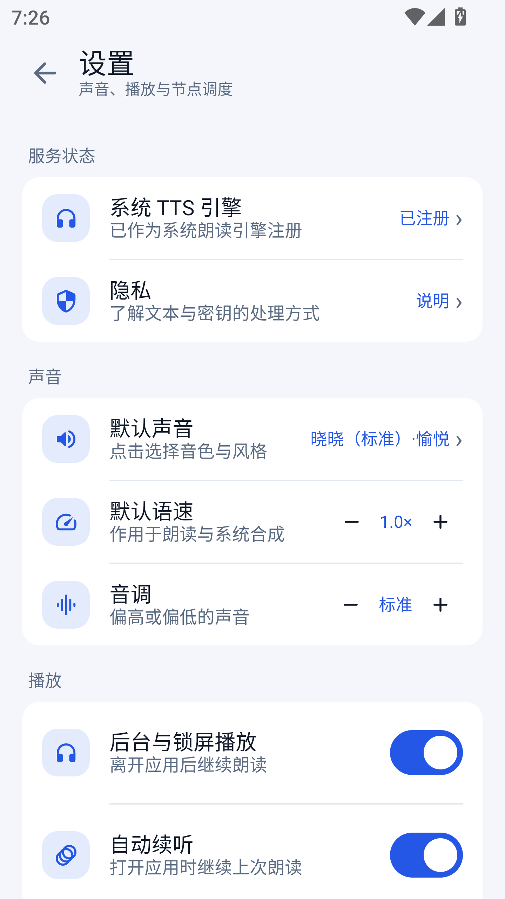
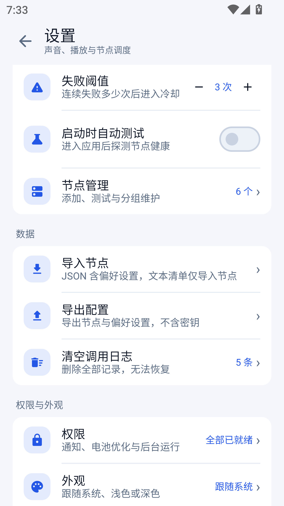
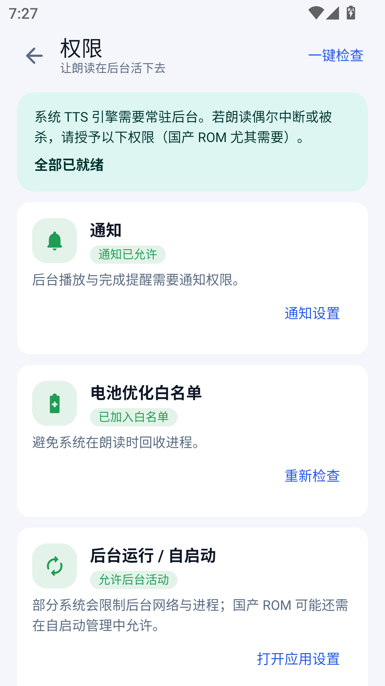

# Pulse

**Pulse（聚合朗读）** 是一款 Android 文本朗读应用与系统 TTS 引擎。它把多个自建 TTS 节点聚合成一个稳定的合成通道：自动挑选可用节点、失败自动切换、连续播放，并可作为系统默认语音引擎供其他应用调用。

<p align="center">
  
  
  
</p>

## 目录

- [功能特性](#功能特性)
- [界面截图](#界面截图)
- [工作原理](#工作原理)
- [节点接口要求](#节点接口要求)
- [快速开始](#快速开始)
- [使用说明](#使用说明)
- [权限说明](#权限说明)
- [项目结构](#项目结构)
- [常见问题](#常见问题)
- [隐私说明](#隐私说明)
- [已知限制](#已知限制)

## 功能特性

### 朗读

- 粘贴或输入长文本，一次请求完成合成后连续播放，播放时按句高亮当前进度
- 播放控制：暂停 / 继续、快退 10 秒、快进 10 秒、倍速、睡眠定时
- 后台与锁屏播放，离开应用后继续朗读
- 再次打开应用可自动续听上次内容
- 支持语速、音调与情感风格调整

### 节点池

- 添加任意数量的 TTS 节点，支持自定义名称、分组与 API Key
- 三种调度模式：
  - **自动**：按健康度与延迟排序，失败后自动切换到下一个节点
  - **按组**：仅使用轮询池中的节点，按顺序轮流调用
  - **手选**：固定使用某个节点
- 启动时自动探测节点健康，也可手动「测试连接」
- 连续失败达到阈值后自动进入冷却，冷却结束自动恢复
- 支持批量导入 URL、JSON 配置导入导出（导出不含密钥）

### 音色

- 内置 958 个音色，离线可浏览与搜索
- 支持按「常用 / 全部 / 中文 / 英语 / 更多」筛选
- 音色按中文名展示，支持风格子集（如 `cheerful`、`sad` 等）

### 系统集成

- 注册为 Android 系统 TTS 引擎，其他应用调用系统朗读时可直接使用
- 系统设置中的「文字转语音输出」可正常识别与试听

### 记录与诊断

- 记录每次合成的节点、耗时、尝试次数、失败原因与节点切换来源
- 按「全部 / 成功 / 失败 / 切换」筛选
- 异常时可快速定位是网络、节点还是配置问题

## 界面截图

| 朗读 | 节点 | 节点详情 |
| --- | --- | --- |
|  |  |  |

| 调用记录 | 音色选择 | 设置 |
| --- | --- | --- |
|  |  |  |

| 设置（数据与外观） | 权限检查 |
| --- | --- |
|  |  |

## 工作原理

```text
系统其他应用 / Pulse 朗读页
            │  speak()
            ▼
  AggregatorTtsService（系统 TTS 引擎）
            │  接收整段文本并请求合成
            ▼
  NodePool（自动 / 按组 / 手选）
            │  健康检查、失败切换、冷却
            ▼
   TTS 节点 A ── TTS 节点 B ── TTS 节点 C
         （HTTP，返回音频字节）
```

- 应用内朗读将合成结果写入缓存文件后由 `MediaPlayer` 播放；系统 TTS 路径则解码为 PCM 交给系统播放
- 节点健康状态、连续失败次数与冷却时间随调用实时更新
- 文本只在本机与所选节点之间传输，不经过任何第三方服务

## 节点接口要求

节点需要兼容以下 HTTP 接口（新老部署均可）：

| 用途 | 接口 | 说明 |
| --- | --- | --- |
| 健康检查 | `GET /api/v1/health` | 新版部署用于判定 V1 |
| 音色列表 | `GET /api/v1/voices` | 新版；老版回退到 `GET /voices` |
| 合成（新版） | `POST /api/v1/tts` | JSON：`text`、`voice`、`rate`、`pitch`、`style` |
| 合成（老版） | `POST /tts` | 字段与新版一致 |
| 合成（兼容） | `GET /tts?text=&t=&v=&r=&p=&s=` | 同时发送 `text` 与 `t` 以覆盖不同部署 |

- 需要鉴权的节点通过 `api_key` 查询参数传递
- 免 Key 节点会被自动识别，无需填写密钥
- 响应应为音频字节（MP3 等），空响应视为失败并触发重试或切换

## 快速开始

### 环境要求

| 项目 | 版本 |
| --- | --- |
| Android | 8.0（API 26）及以上 |
| JDK | 17 |
| Android SDK | API 34 |
| Gradle | 8.7 |
| Kotlin | 2.0.21 |

### 构建 Debug 包

Windows（PowerShell）：

```powershell
$env:JAVA_HOME = "C:\path\to\jdk-17"
.\gradlew.bat :app:assembleDebug
```

macOS / Linux（仓库暂未提供 `gradlew` 脚本，需本地安装 Gradle 8.7）：

```bash
export JAVA_HOME=/path/to/jdk-17
gradle :app:assembleDebug
```

产物路径：`app/build/outputs/apk/debug/app-debug.apk`

安装到已连接设备：

```powershell
adb install -r app\build\outputs\apk\debug\app-debug.apk
```

### 运行单元测试

Windows：

```powershell
.\gradlew.bat :app:testDebugUnitTest
```

macOS / Linux：

```bash
gradle :app:testDebugUnitTest
```

## 使用说明

1. **添加节点**：进入「节点」页，点击右上角 `+`，填写节点地址（如 `https://tts.example.com`），可选填名称与 API Key。
2. **测试节点**：保存后会自动探测；也可在节点详情中点击「测试连接」。
3. **选择调度模式**：在「自动 / 按组 / 手选」之间切换，按需配置轮询池或固定节点。
4. **选择音色**：在朗读页点击音色胶囊，或进入「设置 → 默认声音」。
5. **开始朗读**：在朗读页粘贴文本，点击「开始朗读」；播放页支持倍速、跳转与睡眠定时。
6. **设为系统引擎**：进入「设置 → 系统 TTS 引擎」，将 Pulse 设为默认引擎，其他应用即可调用。
7. **检查权限**：进入「设置 → 权限」，按提示授予通知、电池白名单与后台运行权限。

## 权限说明

| 权限 | 用途 |
| --- | --- |
| `INTERNET` | 访问所选 TTS 节点进行合成 |
| `POST_NOTIFICATIONS` | 后台播放状态与朗读完成提醒 |
| `REQUEST_IGNORE_BATTERY_OPTIMIZATIONS` | 避免朗读过程中服务被系统回收 |

应用内部还会引导跳转到系统的「应用设置」「数据节省设置」「TTS 设置」等页面，用于处理国产 ROM 的后台限制。

## 项目结构

```text
app/src/main/java/com/pulse/tts/
├── data/          # 节点、日志、设置、网络与调度（NodePool / TtsApiClient）
├── playback/      # 播放控制器、朗读时间线与快照
├── tts/           # 系统 TTS 服务、合成引擎、MP3 解码
├── ui/            # Compose 页面、组件、主题与权限逻辑
├── viewmodel/     # 各页面 ViewModel
└── navigation/    # 页面栈与底部导航
```

- 节点与日志使用系统自带 SQLite 存储，设置使用 SharedPreferences + JSON
- 音色清单打包在 `app/src/main/assets/voices.json`

## 常见问题

**节点显示「冷却中」怎么办？**

连续失败达到阈值后节点会进入冷却，可在「设置 → 失败冷却」调整时长，或在节点详情中手动测试连接。冷却结束会自动恢复。

**设为系统引擎后其他应用没有声音？**

先确认「设置 → 系统 TTS 引擎」显示已注册，再在系统「文字转语音输出」中确认默认引擎为 Pulse，并检查电池优化白名单。

**朗读中途被系统杀掉？**

进入「权限」页完成通知、电池白名单与后台运行设置；部分国产 ROM 还需在自启动管理中允许。

**导出的配置包含密钥吗？**

不包含。导出内容为节点地址、名称、分组与偏好设置，API Key 不会写入导出文件。

**支持哪些节点服务？**

兼容提供 `/api/v1/tts`、`/tts` 或 `/voices` 的 HTTP TTS 服务，新老两代部署均可。

## 隐私说明

- 朗读文本仅在本机与所选节点之间传输，不经过其他服务器
- API Key 仅保存在本机应用数据中，导出配置时不会包含
- 调用记录仅存于本机，可随时清空

## 已知限制

- 仅支持 Android 8.0 及以上版本
- 系统 TTS 引擎的可用性受各厂商 ROM 的后台策略影响
- 暂未提供 iOS / 桌面端
- 仓库暂未包含 macOS / Linux 的 `gradlew` 脚本，需使用本地 Gradle
